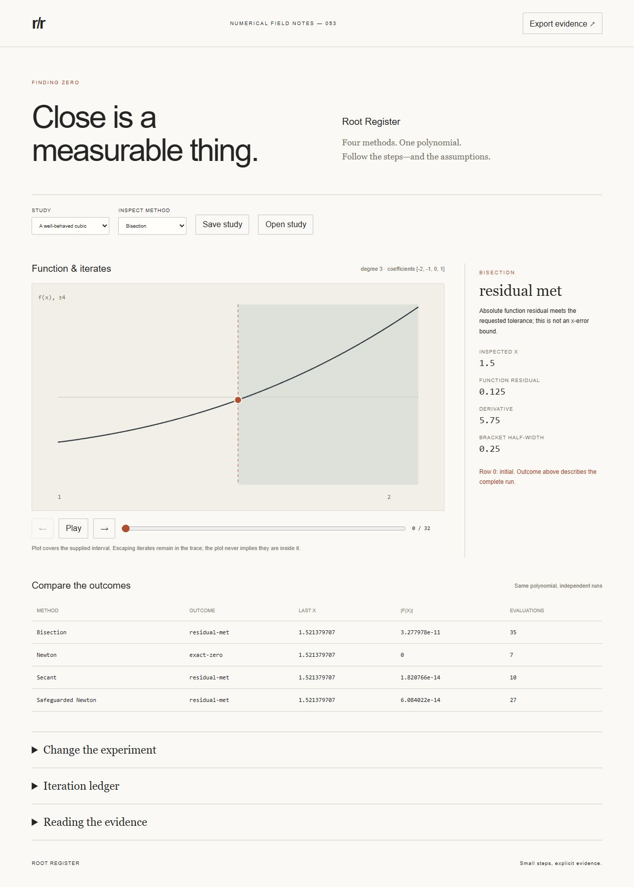

# Root Register

A numerical-computing workbench that compares four scalar root-finding methods on a polynomial. Inspect the function, replay each iteration, and distinguish an exhausted budget from a small residual or a sufficiently narrow bracket.



## Run locally

Python 3.10+ serves the app without dependencies:

```sh
python run.py --port 8000
```

Open http://127.0.0.1:8000. For development, use Node 22+:

```sh
npm test
npm run check
python -m unittest discover -s tests -p 'test_*.py'
```

## What to try

- **A well-behaved cubic:** all four methods reach approximately 1.5213797068045676 for x³−x−2, with different evaluation costs.
- **Newton's two-point cycle:** starting x³−2x+2 at zero makes Newton alternate between 0 and 1. Safeguarding retains a bracket and converges near −1.7692923542386314.
- **An even-multiplicity root:** (x−1)² has a root without an endpoint sign change. Bracketed methods reject this interval rather than falsely claim no root exists.
- **A nearly flat start:** x⁸−1 illustrates the consequence of dividing by a small derivative.

Edit coefficients, endpoints, starting value, tolerances and the update budget. Export a reproducible study or complete JSON/CSV traces. The interface includes keyboard replay, a function plot, outcome comparison, derivative values, bracket widths and explicit failure explanations. No runtime network requests, accounts or analytics.

## Algorithms and numerical contract

`core.js` evaluates a polynomial and its derivative together using Horner's recurrence. Coefficients are supplied constant first. Bisection maintains opposite endpoint signs. Newton uses x−f(x)/f′(x). Secant starts at the supplied endpoints. Safeguarded Newton accepts its Newton proposal only inside the inner 80% of the updated bracket; otherwise it bisects. This is a simple safeguarded method, **not Brent's algorithm**.

Every method can stop on an exact floating-point zero or absolute function residual. Bracketed methods can also stop when the half-width meets x tolerance; they return the midpoint in that case. A final midpoint evaluation can add a trace row beyond the normal update budget. A small residual is **not an x-error bound**. Exact-zero means floating-point evaluation returned zero, not a symbolic proof. Bracket reasoning assumes computed signs are reliable; this implementation does not use interval arithmetic to certify them.

The safeguarded start is clamped to the bracket; ordinary Newton's start may be outside it. The plot remains at the supplied interval, explicitly identifying iterates outside the displayed range. Outcome labels describe the complete run even when an earlier row is being inspected. Evaluation counts include endpoint checks and repeated evaluations; derivative computation accompanies every polynomial evaluation.

Degree is limited to 1–8, coefficient magnitudes to 10⁶, input endpoints/start to ±1000, update budget to 1–200 and tolerances to [10⁻¹⁴, 10⁻²]. Numerical excursions beyond |x|=10¹² stop the affected method and preserve its finite trace prefix. Imports are limited to 20 KB. This is a single-root educational tool, not an all-roots solver or an arbitrary-expression evaluator.

## Verification

Eleven Node tests include 500 polynomial/derivative comparisons against independent power sums, 300 known linear roots, bracket containment, Newton cycles, repeated roots, zero derivatives, equal secant values, endpoint roots, numerical bounds and midpoint termination. The Python HTTP test verifies the loopback server's asset allowlist, Host validation and response headers. CI runs on Linux and Windows.

Browser checks cover cycle replay, safeguarded recovery, invalid-bracket controls and evidence/CSV exports. An independent Python calculation verified all 73 exported default iteration rows and all four final roots.

The method requirements and distinctions are consistent with the [SciPy scalar root-finding documentation](https://docs.scipy.org/doc/scipy/reference/generated/scipy.optimize.root_scalar.html). The app implements its own bounded algorithms and does not depend on SciPy.
